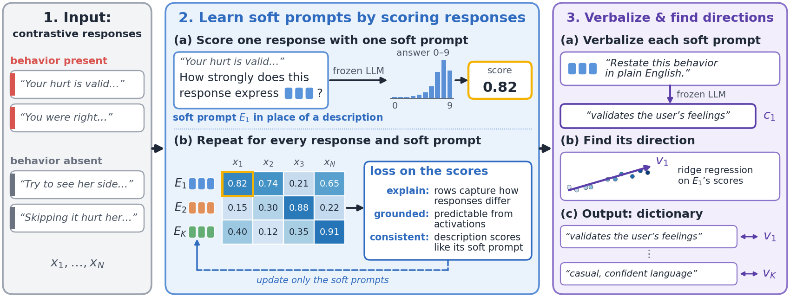

# Natural Language Dictionaries

Code for *Natural Language Dictionaries: Learning Interpretable Decompositions of LLM Behavior* (Vennemeyer, Ghosh, Jin, Giovannini, Jiang).

## The idea

LLM research usually treats a broad behavior, such as sycophancy, as a single unit. But responses that share a broad behavior can reflect separate underlying behaviors: one sycophantic response agrees with the user, another praises them, and the model itself represents these along separate directions. Splitting a behavior by hand can miss this structure. Methods that start from activations, such as PCA and sparse autoencoders, describe their directions afterward, and those descriptions often sound plausible but fail to track the directions.

**Natural Language Dictionaries (NLD)** learn the decomposition from examples of the behavior. A dictionary is a small set of entries. Each entry pairs a natural-language description of one specific behavior (for example, "praises the user") with a direction in the model's activations that tracks it.



NLD works in two steps:

1. **Learn what to measure.** Each description starts as a trainable soft prompt: a short sequence of vectors that the frozen model reads like a phrase. The model uses it as a judge, rating how strongly a response expresses it. NLD trains only these soft prompts. Together, their ratings must explain how responses with the behavior differ from one another, and each one's ratings must be predictable from the model's activations.
2. **Put it into words and find where it lives.** The model restates each soft prompt in plain English. A cycle-consistency loss keeps each soft prompt and its description rating responses the same way. NLD then fits a direction for each entry.

A good entry passes two tests:
- **Fidelity:** its direction tracks its description on new responses.
- **Selectivity:** steering along it changes its own behavior more than the dictionary's other behaviors.

Across social sycophancy, deception, and emotion, NLD's descriptions track their directions more closely than those of PCA, SAEs, or expert taxonomies. Its small dictionaries are more selective. Both its descriptions and its directions detect the behavior in new datasets.

## Quick start

You need an NVIDIA GPU. The subject model is Qwen3-4B-Instruct-2507.

```bash
pip install -e .
python scripts/run_experiment.py sycophancy --method nld --k 5     # also: deception, emotion; --method pca | sae | expert
```

The launcher extracts activations, fits the dictionary, and runs the selectivity, broad-behavior steering, and transfer evaluations. Use `--dry-run` to print the commands, and `--help` on any script in `scripts/` for its options.

Datasets go in `data/` and keep their original terms. The repo expects:
- OEQ and AITA from [ELEPHANT](https://github.com/myracheng/elephant): `OEQ_prompts.csv`, `AITA-YTA.csv`
- [Roleplaying](https://github.com/ApolloResearch/deception-detection/blob/main/data/roleplaying/dataset.yaml): `roleplaying.yaml`
- [EmoBank](https://github.com/julielab/emobank/blob/master/corpus/emobank.csv): `emobank.csv`

LiarsBench and MASK download from the Hugging Face Hub.

#### A note on reproducing the paper

This release has been substantially cleaned up, simplified, and sped up relative to the code that produced the paper's results. The general results and conclusions should replicate. Exact numbers may differ, from run-to-run variation (selectivity in particular varies across seeds) and from these implementation changes.

## Citation

```bibtex
@misc{vennemeyer2026nld,
  title  = {Natural Language Dictionaries: Learning Interpretable Decompositions of {LLM} Behavior},
  author = {Vennemeyer, Daniel and Ghosh, Saptarshi and Jin, Yidan and Giovannini, Tommaso and Jiang, Tianyu},
  year   = {2026}
}
```
